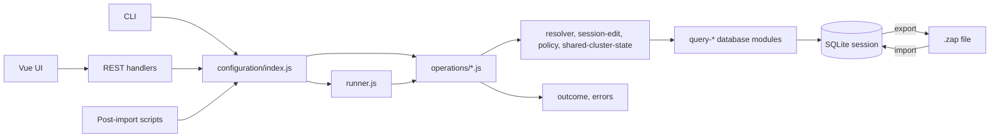

# ZAP configuration commands

ZAP's configuration CLI edits `.zap` files from a terminal. It uses the same
configuration operations as the user interface, so endpoint, cluster, element,
and Matter feature changes follow the same validation and data model rules.
This page summarizes how to use the CLI and how it is implemented.

## Start here

From an installed ZAP package, run `zap <command>`. From a source checkout:

```bash
npm run zap-cli -- help
npm run zap-cli -- endpoint list light.zap
```

Use `zap help` to list all operations, `zap help attribute` to see a command
group, and `zap help attribute set` for one operation's options. For Matter
configurations, specify the Matter metadata; the default is Zigbee:

```bash
zap endpoint list light.zap --zcl ./zcl-builtin/matter/zcl.json
```

Add `--gen <template.json>` when generation templates are needed. A command
accepts the `.zap` file as a positional argument and uses GUI endpoint IDs, not
database row IDs.

## Typical workflow

1. Inspect an unfamiliar file with `zap info`, `zap check`, and the `list`
   operations. Listings can use `--filter`, `--enabled-only`, and `--all`.
2. Resolve names from the loaded data model. Selectors accept names, define
   names, or numeric codes, ignoring case and punctuation. Ambiguous names are
   reported; unknown names include close matches.
3. Apply edits with operations such as `endpoint create`, `cluster enable`,
   `attribute set`, `command enable`, `event enable`, and `feature enable`.
4. Run `zap check` to inspect validation findings and notifications, then run
   `zap generate` if code generation is needed.

For example, create a Matter dimmable light and set its current level:

```bash
MATTER="--zcl ./zcl-builtin/matter/zcl.json --gen ./test/gen-template/matter/gen-test.json"
zap new light.zap $MATTER
zap endpoint create light.zap --endpoint 1 --device-type MA-dimmablelight $MATTER
zap attribute set light.zap --endpoint 1 --cluster "Level Control" \
  --attribute CurrentLevel --enabled --default 25 $MATTER
zap check light.zap $MATTER
```

Run multiple edits from one YAML or JSON script with `zap apply`. Script
operation names use dots (`attribute.set`); option names use camelCase:

```yaml
- op: endpoint.create
  endpoint: 1
  deviceType: MA-dimmablelight
- op: attribute.set
  endpoint: 1
  cluster: Level Control
  attribute: CurrentLevel
  enabled: true
  default: '25'
```

```bash
zap apply light.zap --script changes.yaml $MATTER
```

`zap apply` uses one session and writes only after all operations succeed; a
failed batch leaves the file unchanged. `--dry-run` previews an edit without
writing. Use `--format json` for machine-readable output, and `--strict` to
refuse saving when an edit introduces validation errors.

## Configuration behavior

- **Endpoints:** create, update, duplicate, and delete endpoints; assign device
  types and parent relationships. Device types can enable their required
  clusters and elements.
- **Clusters and elements:** enable or disable clusters, attributes, commands,
  and events. Attribute options include default, storage, singleton, and
  reporting fields where the data model permits them.
- **Matter features:** `feature list` and `feature requirements` inspect current
  state. `feature preview` shows conformance-driven consequences;
  `feature enable` or `feature disable` applies the change. The same shared
  operation produces the preview and applies the confirmed plan.
- **Multiprotocol files:** pass each relevant `--zcl` metadata file. Endpoint
  numbers can overlap across categories, so specify `--category` to disambiguate.
  Shared cluster behavior follows the loaded generator metadata rather than a
  protocol-name check.
- **Policy:** fields fixed by the data model are refused with an explanation.
  ZAP reapplies some policy on import, so a change that would disappear on the
  next read is not reported as successful.
- **Results:** mutations report newly introduced validation findings and
  notifications. `zap check` reports the full current state. Notifications are
  recomputed on import and by validation; they are not cached in `.zap` files.

## How it is built



Everything shared lives under `src-electron/configuration/`, and it is the only
place configuration behaviour is decided. Each interface is a thin adapter that
translates its inputs into a call and renders the answer its own way:

```
src-electron/configuration/
├── index.js               the boundary every interface calls
├── runner.js              run one operation and reconcile shared state (CLI)
├── operations/
│   ├── index.js           the registry: dotted name -> operation
│   ├── endpoint.js        one module per subject, each contributing its slice
│   ├── device-type.js
│   ├── cluster.js
│   ├── studio-components.js
│   ├── attribute.js
│   ├── command.js
│   ├── event.js
│   ├── feature.js
│   ├── package.js
│   ├── config.js
│   └── listing.js         filters and follow-up steps for the listings
├── session-edit.js        the write sequence and the rules that gate it
├── resolver.js            names, codes and ids to database rows
├── policy.js              what the data model fixes, and why
├── shared-cluster-state.js
├── reads.js               plain reads, in the rows a script walks
├── outcome.js             the result shape: messages, warnings, table, next steps
└── errors.js              OperationError: message, hints, remedies
```

An operation answers in data, never in a rendered form. A result is
`{ changed, messages, warnings, table, next }`, where `next` is a list of
`{ op, params }` steps worth running afterwards. A refusal is an
`OperationError` carrying prose `hints` and `remedies`, the steps that would
make the request possible, built by `session-edit` itself where the rule is
enforced. Nothing in the engine knows what a `zap` command line looks like; a
test (`configuration: the engine knows no interface`) checks that it never
requires an interface module, never writes SQL, and never builds a command.

The three adapters differ only in how they report and when they reconcile:

- The CLI (`src-electron/cli/`) runs each operation through `runner.js`, which
  aligns shared cluster states after every edit. `cli-output.js` renders steps
  as paste-able commands (`zap cluster enable file.zap --endpoint 1 ...`) and
  prefixes warnings; `startup.js` prints a refusal's hints and remedies the
  same way.
- A REST handler (`src-electron/rest/`) passes the user interface's database
  ids straight to the operation (`endpointId`, `clusterId`, `attributeId`); the
  resolver accepts them alongside names. A refusal is answered as HTTP 400 with
  `{ message, hints, remedies }`. The interface aligns shared cluster states
  itself, as it always has, so the handler does not.
- A post-import script (`src-electron/util/post-import-api.js`) applies a
  batch: warnings are printed from `outcome.warnings`, a refusal is printed
  with its remedies as `op {params}` and the call returns `null`, and shared
  cluster states are aligned once when the script function returns.

The CLI's command surface lives in `src-electron/cli/cli-spec.js`. The parser
and human or JSON help are generated from that declaration. Database access
must go through the existing `query-*` modules; do not add SQL or reimplement
REST behavior in a command handler.

Validation recomputes requirements from current configuration. Notifications
record conditions observed during import or edits, including trigger-generated
states. The UI and CLI therefore see the same underlying configuration and
policy results.

## Tests and extension points

The CLI tests cover the command surface, operation behavior, machine-readable
output, batch atomicity, and policy refusals. Feature integration tests exercise
preview and apply through REST and the shared operations. To add an operation:

1. Implement it in the subject module under
   `src-electron/configuration/operations/` using existing query modules, and
   add it to that module's `operations` table. Return a result from
   `outcome.result`, name follow-ups with `outcome.step`, and refuse with an
   `OperationError` whose remedies are steps.
2. Describe it in `src-electron/cli/cli-spec.js` if it is part of the CLI.
3. Route UI edits through the REST operation adapter and refresh the UI state
   from the resulting database state.
4. Add tests for the operation and its callers.

For details on all accepted flags and operations, run `zap help` or
`zap help <group> <operation>`; the command output is generated from the live
CLI specification.
